# Reskon

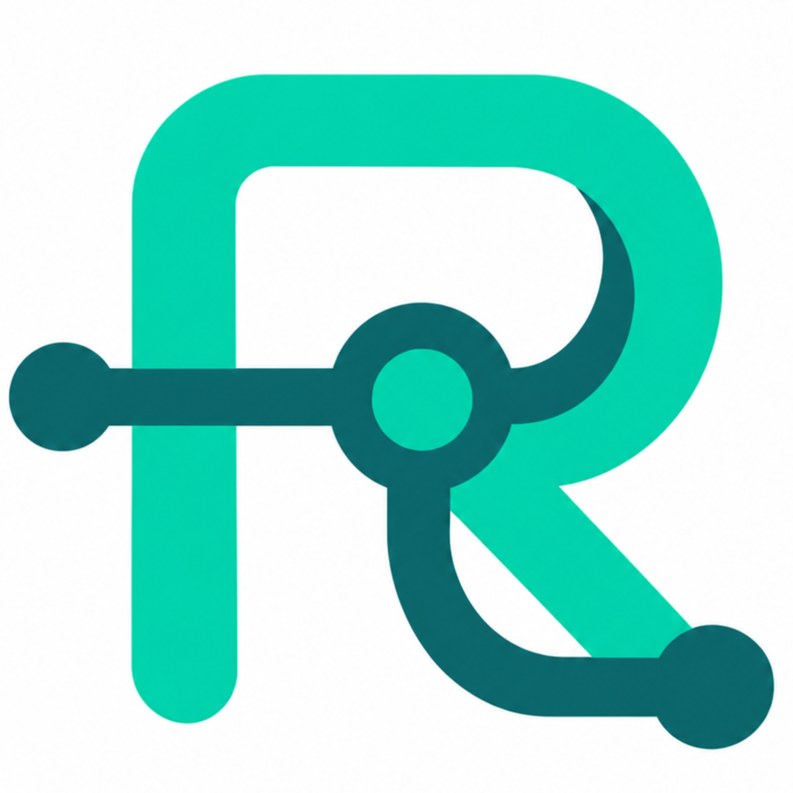

**A task board and a time log for your whole life: work, health, home, hobbies and rest.**

Keep your tasks on a board, write down the time you spend on things, plan your day, and see what your days and weeks really looked like. Reskon runs on your own computer or home server, so your data stays with you. An Android app works fully offline and syncs with your server when it can reach it.

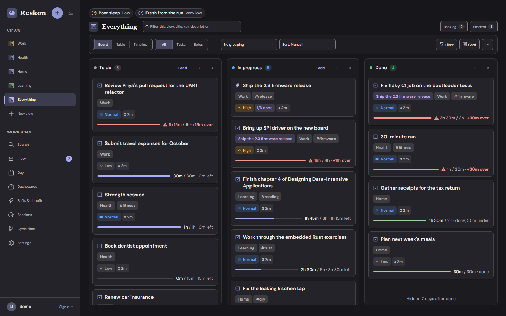

## What it does

- **Everything counts.** Sleep, a walk and an evening of games earn points just like work does. No kind of activity is worth more than another, and the app never shows "work minus rest" scores, streaks or grades.
- **Tasks on a board.** Columns for each status, drag cards between them, and switch to a table or a timeline. Each card shows how long the task has been waiting and how much of its estimate is used.
- **A time log.** Each session records what you did, for how long, what kind of energy it took (Engineering, Physical, Admin, Rest, Leisure…), and how it felt.
- **Quick capture.** Type one line, like *"Worked on the SPI driver, 2 hours"*, and it becomes a task or a session. If you connect an AI model, it fills in the form for you. Nothing is saved until you check it.
- **A day planner.** Plan today's tasks and events against the time you actually have, run a timer, and tick things off.
- **Buffs and debuffs.** Note things that affect you for a few days, like *Poor sleep* or *Fresh from the run*, and watch them fade.
- **Dashboards.** Charts of your hours and points by day, week or month, built from what you logged.
- **Your own lists.** Areas, statuses, priorities, energy types and tags are all yours to rename, recolour, add and remove.
- **Several people, one server.** Each person gets a separate database, so no one ever sees anyone else's data.

## A look around

### The Day screen

Today's plan beside your open tasks. At the top: how much time is free, what is planned and what is already logged. It is off until you switch it on under **Settings › Screens**.

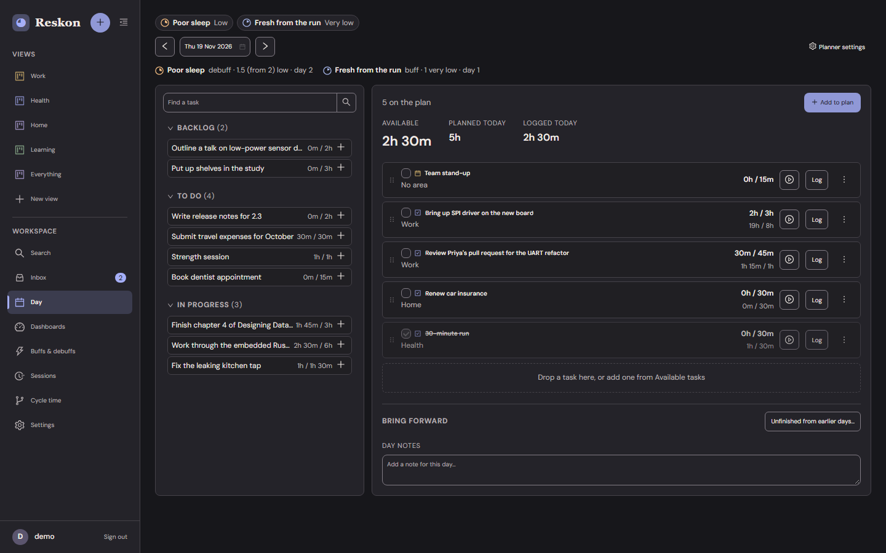

### A task

Click any card to open its details: status, area, priority, estimate, dates, tags, subtasks and every move it has made.

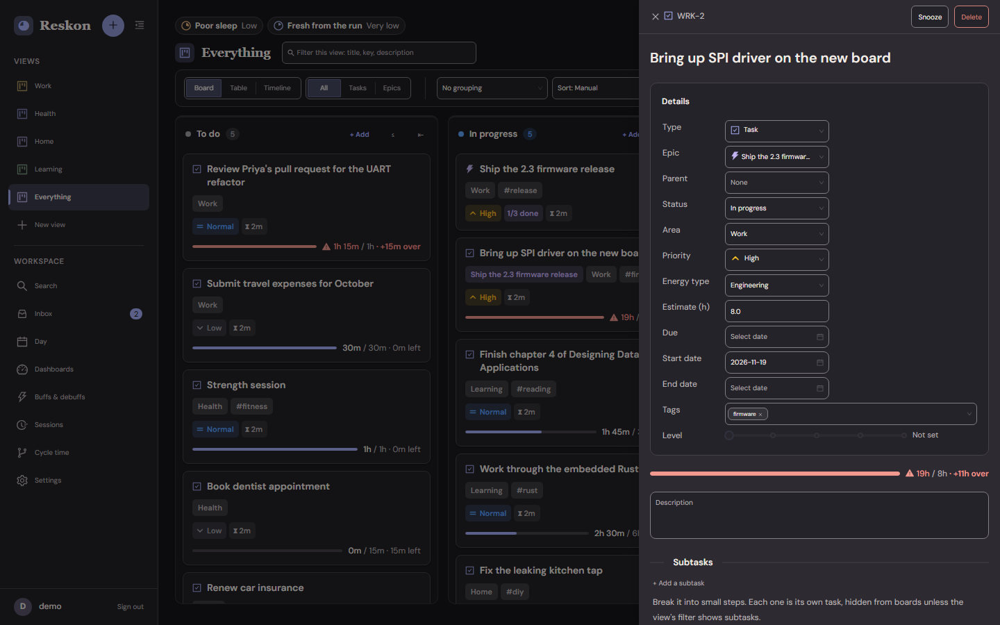

### Sessions

Everything you logged, day by day, with each day's hours per energy type. Filter by energy type, area, tag or task, or copy a day as text.

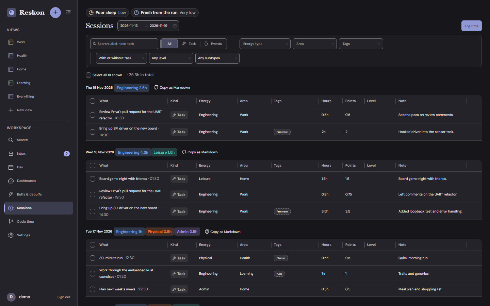

### Quick capture

Press **Ctrl+K** (⌘+K on a Mac) or the round **+** button anywhere. As you type, it suggests tasks you already have.

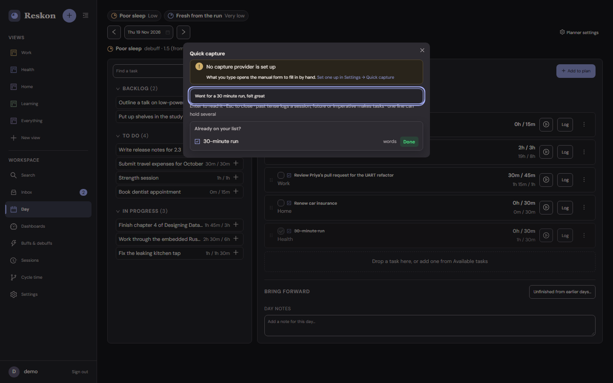

### Dashboards

Charts and lists you arrange yourself: open tasks, hours and points over the last week, buffs in force, and more.

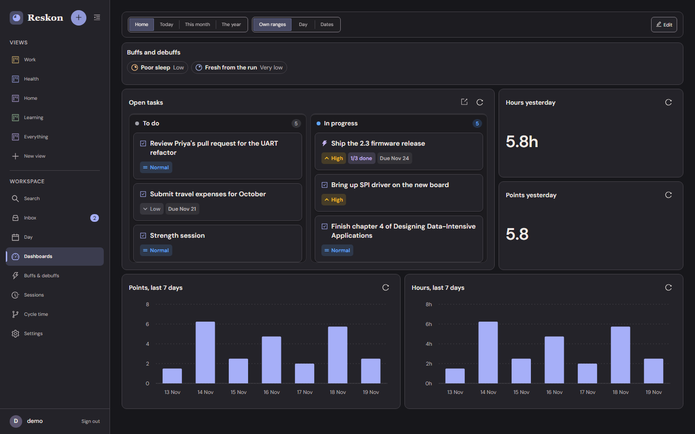

### Buffs and debuffs

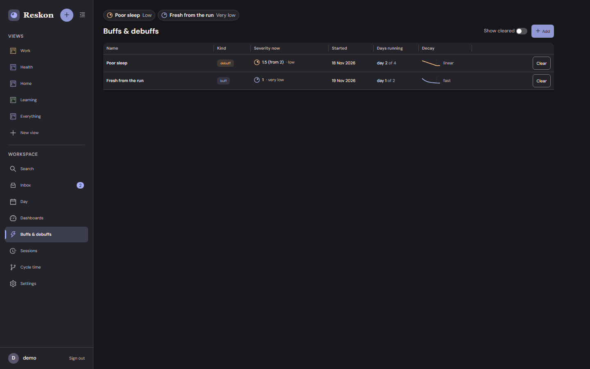

### Settings

Every list in the app is yours to change. Settings has a search box at the top.

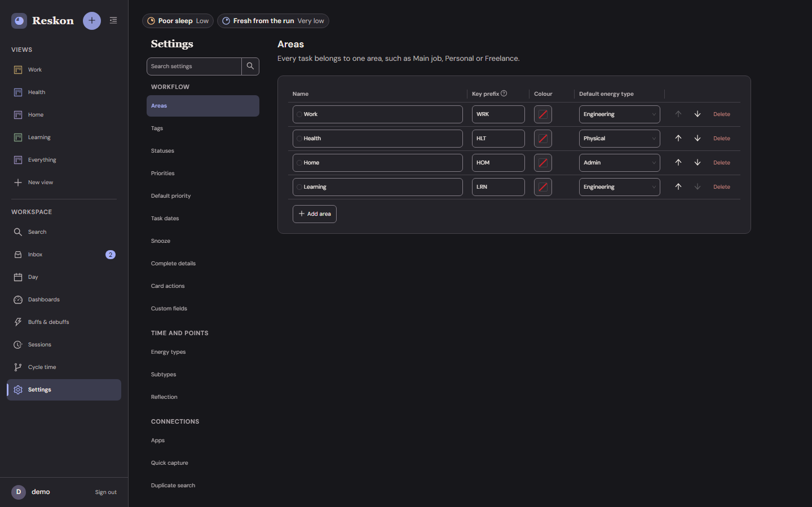

## The phone app

The Android app has the same tasks, sessions, planner and dashboards. It works with no server and no internet at all. Connect it to your server whenever you like, and the phone and the server keep each other up to date. If both change the same task, the latest change to each field wins.

<p>
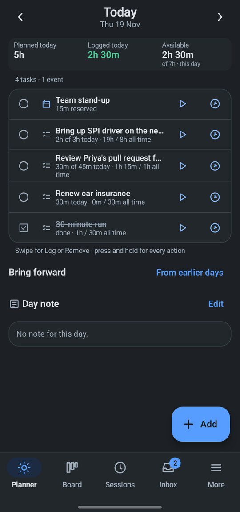
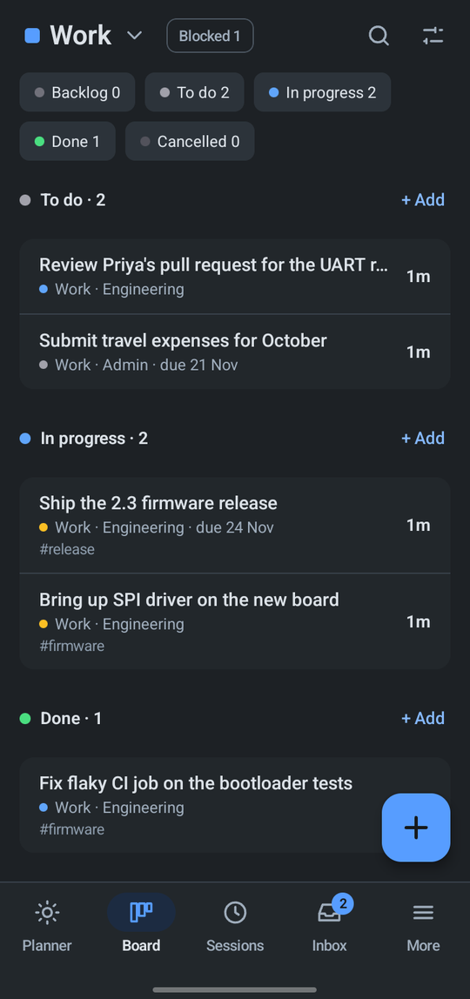
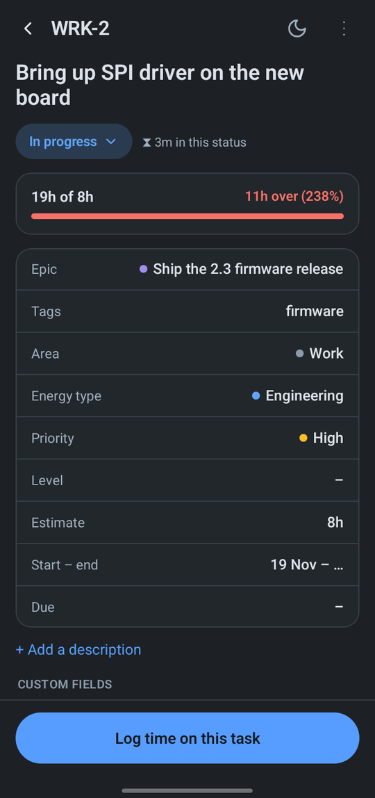
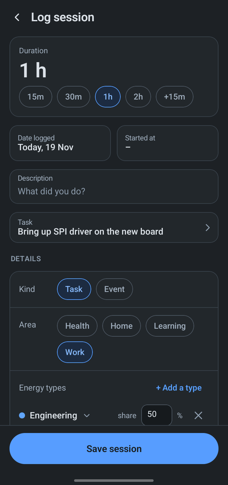
</p>
<p>
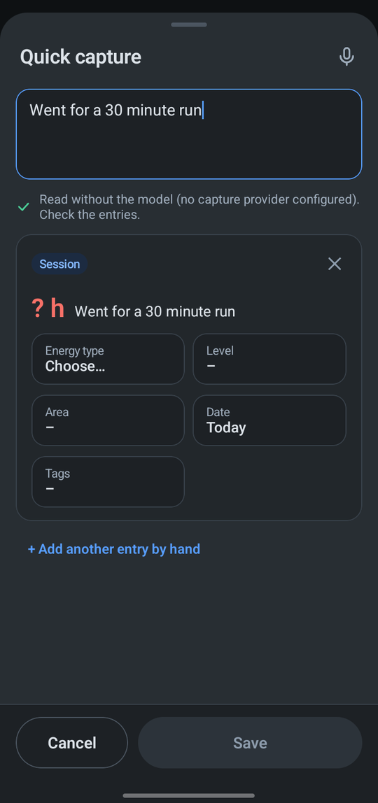
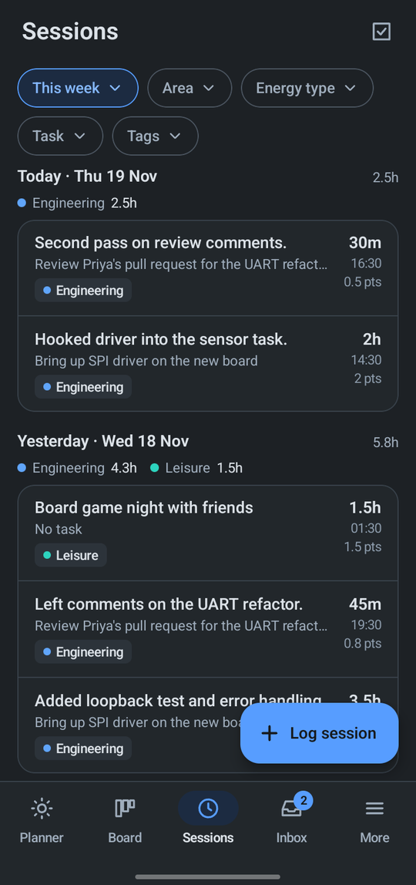
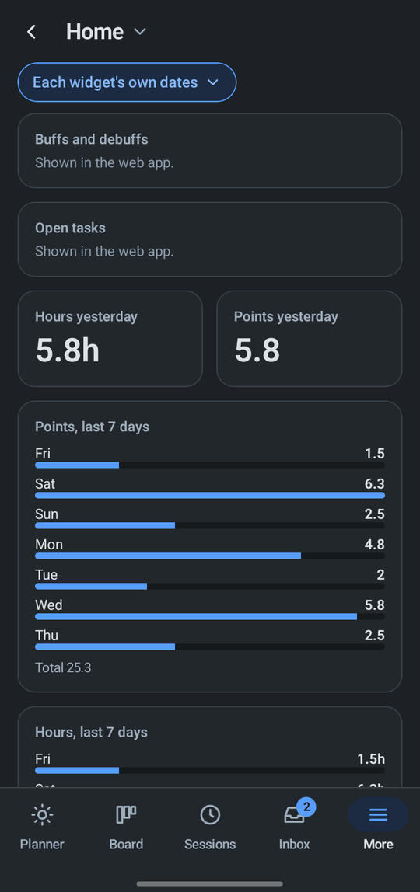
</p>

On the phone, boards show as a list grouped by status (or by priority, area and so on), so there is no sideways scrolling.

## Getting started

### 1. Start the server

Reskon is one program. The easiest way to run it is with Docker on a computer that stays on (a home server, a NAS or a small always-on PC):

```sh
git clone https://github.com/CreativeCheebs/Reskon.git
cd Reskon
docker build -t reskon .
docker run -d --name reskon -p 8080:8080 -v reskon-data:/data -e TZ=Europe/London reskon
```

Set `TZ` to your own time zone so "today" starts at your midnight. All your data lives in the `reskon-data` volume (a storage folder Docker keeps for you), so it survives updates.

To run it without Docker, or to change the port, the data folder or other settings, see [docs/developer.md](docs/developer.md).

### 2. Create your account

Open `http://<your-server>:8080` in a browser. The first person to open a new server creates the **admin** account. After that there is no open sign-up: the admin adds other people under **Settings › People**, and can reset a password or disable an account (their data is kept).

Then Reskon asks for your first **area**, the big part of life a task belongs to, such as *Work*, *Home* or *Health*. You can add more any time.

> If other people can reach your server, add `-e JITTERBUG_SETUP_TOKEN=<a word you choose>` to the `docker run` line before you first open it. The first-run screen then asks for that word, so no one else can claim your new server. If it faces the internet, put it behind HTTPS.

### 3. Get the phone app (optional)

Install the Reskon APK on your Android phone: ask whoever runs your server for it, or build it yourself ([docs/developer.md](docs/developer.md#build-the-phone-app)). Copy it to the phone and open it; Android asks once to allow installing it. At first start it asks *"Do you have a Reskon server?"*:

- **Connect to a server**: type your server's address and your username and password. Everything is downloaded once, then it syncs by itself a few seconds after each change and every 5 minutes.
- **Offline**: use the phone on its own. You can connect a server later under **Settings › Sync server**.

### 4. Turn on AI capture (optional)

Quick capture works without AI: you fill in the form yourself. To have a model fill it in for you, go to **Settings › Quick capture** and enter an AI service that speaks the common "OpenAI-style" language (most do, including Ollama running on your own machine): its address, a model name and, if it needs one, a key. If the model is slow or down, capture simply falls back to the plain form.

## Everyday tips

| To… | Do this |
| --- | --- |
| Capture a task or session | **Ctrl+K** (⌘+K) or the round **+** button |
| Drop a thought in the inbox for later | **Ctrl+I** (⌘+I), or the phone's Inbox tab |
| Move a task | Drag its card, or open it and change **Status** |
| Log time | **Log time** on the Sessions screen, or **Log** on a Day plan line |
| Hide a task until later | Open it and press **Snooze** |
| Change the look (web) | **Settings › Appearance**: System, Light, Dark, Jira, GitHub Dark and more. You can download a theme, edit its colours and upload it back. The phone is always dark |
| Change your password | **Settings › Account**. Forgot it? Ask the admin to reset it |
| Call tasks something else | **Settings › Names**, for example *todo* or *story* |
| Bring tasks over from Jira | See [docs/developer.md](docs/developer.md#import-from-jira) |

## Updating to a new version

Your data stays in the volume, so you can replace the program freely. Back up first (see below), then:

```sh
cd Reskon
git pull
docker build -t reskon .
docker rm -f reskon
docker run -d --name reskon -p 8080:8080 -v reskon-data:/data -e TZ=Europe/London reskon
```

Reskon updates your data to the new version by itself when it starts. The version you are running is shown under **Settings › About**.

## Keeping your data safe

Reskon keeps every person's data in its own file. To back everything up while it is running:

```sh
docker exec reskon jitterbug backup /data/backup-$(date +%F)
```

This writes a full copy into a new folder inside the data volume. That is still the same disk, so copy it somewhere else too, for example:

```sh
docker cp reskon:/data/backup-2026-11-19 ./reskon-backup-2026-11-19
```
 How to restore it is in [docs/developer.md](docs/developer.md#restore).

On the phone, **Settings › Download database** saves a copy of everything on the phone as one file.

## More

- [SPEC.md](SPEC.md) describes everything the app does, in plain English.
- [docs/developer.md](docs/developer.md) covers building, running, settings and versions.
- [docs/decisions.md](docs/decisions.md) explains why things work the way they do.
- [docs/plugins.md](docs/plugins.md) shows developers how to connect other apps (a draft).
